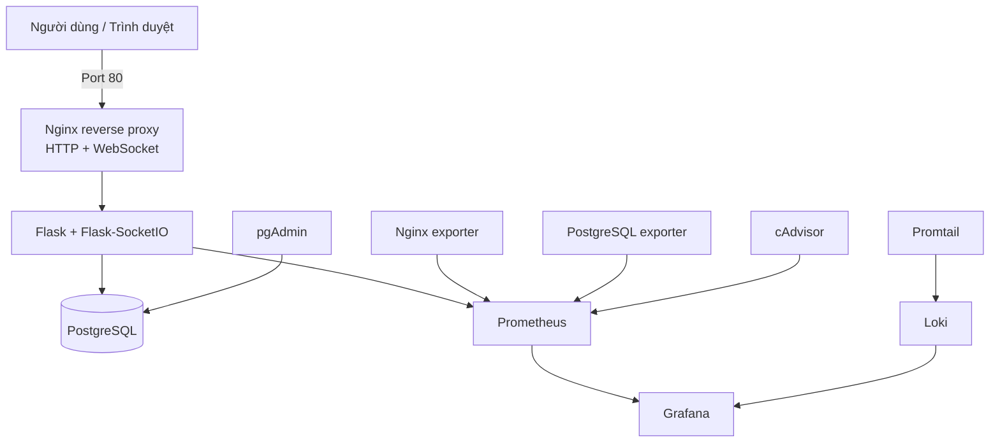

# Đề 32 – LinhChat: Hệ thống Chat/Messaging nội bộ

## Thông tin dự án

 Học phần Triển khai và quản trị hệ thống 
 Đề tài Đề 32 – Hệ thống Chat/Messaging nội bộ 
 Tên sản phẩm: LinhChat 
 Mã số sinh viên: DTC245200025 
 Môi trường triển khai: Ubuntu 24.04 trên VMware 
 Repository: <https://github.com/dtc245200025-sudo/DTC245200025>
 Trạng thái: Hoàn thành và đã kiểm thử trên Ubuntu VM 

LinhChat là ứng dụng chat nội bộ được triển khai hoàn toàn bằng Docker Compose. Hệ thống sử dụng Flask-SocketIO để xử lý giao tiếp thời gian thực, PostgreSQL để lưu dữ liệu, Nginx làm reverse proxy, Prometheus/Grafana để giám sát và Loki/Promtail để tập trung nhật ký.

Kết quả kiểm tra cuối:
- 11/11 service hoạt động.
- 152/152 bài kiểm thử đạt.
- PostgreSQL có đủ 10 bảng theo mô hình dữ liệu cuối.
- Prometheus có 5/5 targets ở trạng thái `UP`.
- Grafana có 11 panel theo dõi 11 service.
- Loki nhận log và ba truy vấn LogQL có dữ liệu.
- Ba mốc commit bắt buộc được giữ nguyên trong lịch sử Git.

## Mục tiêu

- Xây dựng ứng dụng chat nội bộ có tài khoản, phòng chat và tin nhắn thời gian thực.
- Lưu dữ liệu bền vững trong PostgreSQL và quản trị bằng pgAdmin.
- Đóng gói toàn bộ thành phần bằng Docker Compose.
- Đặt Nginx làm điểm truy cập web và proxy WebSocket.
- Theo dõi ứng dụng, reverse proxy, database và container bằng Prometheus/Grafana.
- Thu thập log tập trung bằng Loki/Promtail và truy vấn bằng LogQL.
- Áp dụng các biện pháp hardening cho container, mạng, HTTP, tài khoản và bí mật.
- Cung cấp README, script kiểm tra, kịch bản demo và lịch sử commit rõ ràng để phục vụ báo cáo cuối kỳ.

## Kiến trúc hệ thống



Luồng chính:

1. Người dùng truy cập Nginx bằng HTTP.
2. Nginx chuyển tiếp HTTP và WebSocket/Socket.IO đến Flask.
3. Flask xử lý nghiệp vụ và lưu dữ liệu vào PostgreSQL.
4. Prometheus thu metrics từ app, Nginx, PostgreSQL, cAdvisor và chính Prometheus.
5. Grafana hiển thị dashboard Prometheus và truy vấn log từ Loki.
6. Promtail đọc log container, gắn nhãn service và chuyển log đến Loki.

## Thành phần triển khai

| Service | Vai trò | Phạm vi truy cập |
|---|---|---|
| `nginx` | Reverse proxy HTTP/WebSocket và security headers | Công bố cổng `80` |
| `app` | Flask, Flask-SocketIO và metrics ứng dụng | Chỉ trong mạng Docker |
| `postgres` | Cơ sở dữ liệu nghiệp vụ | Chỉ trong mạng backend |
| `pgadmin` | Quản trị PostgreSQL | `localhost:5050` |
| `prometheus` | Thu thập và lưu metrics | `localhost:9090` |
| `grafana` | Dashboard metrics và truy vấn log | `localhost:3000` |
| `loki` | Lưu log tập trung | Chỉ trong mạng Docker |
| `promtail` | Thu thập log container | Chỉ trong mạng Docker |
| `cadvisor` | Metrics CPU/RAM của container | Chỉ trong mạng Docker |
| `postgres-exporter` | Metrics PostgreSQL | Chỉ trong mạng Docker |
| `nginx-exporter` | Metrics Nginx | Chỉ trong mạng Docker |

## Chức năng LinhChat

### Tài khoản và giao diện

- Đăng ký bằng username, email và mật khẩu.
- Đăng nhập bằng username hoặc email.
- Mật khẩu được hash trước khi lưu, không lưu dạng văn bản thuần.
- Giao diện sáng màu trắng/hồng nhạt và giao diện tối màu tím than.
- Profile gồm tên hiển thị, username cố định, giới thiệu, avatar, ngày tham gia và quyền riêng tư.
- Đổi mật khẩu bằng cách xác nhận mật khẩu hiện tại; các phiên đăng nhập cũ bị thu hồi sau khi đổi.

### Phòng chat

- Tạo và tìm kiếm phòng chat.
- Phòng `Public` hỗ trợ giới hạn từ 2 đến 500 thành viên.
- Phòng `Private` hỗ trợ mật khẩu, phê duyệt hoặc liên kết mời.
- Chủ phòng quản lý yêu cầu tham gia, liên kết mời và thành viên.
- Kiểm tra quyền ở cả HTTP và Socket.IO.

### Bạn bè và chat riêng

- Tìm người dùng theo username, tên hiển thị hoặc email đầy đủ.
- Gửi, chấp nhận, từ chối, thu hồi lời mời và hủy kết bạn.
- Trạng thái online/offline và số lời mời cập nhật theo thời gian thực.
- Chat riêng giữa hai người dùng; lịch sử vẫn được giữ khi hủy kết bạn.

### Tin nhắn nâng cao

- Tin nhắn phòng và tin nhắn riêng cập nhật realtime.
- Hiển thị trạng thái đang nhập.
- Trạng thái đã gửi, đã nhận và đã xem kèm thời gian.
- Tìm kiếm tin nhắn theo nội dung hoặc tên tệp.
- Gợi ý emoji khi soạn tin.
- Gửi ảnh và tệp tối đa 10 MiB.
- Kiểm tra quyền trước khi tải tệp; ảnh được kiểm tra nội dung và tạo bản xem trước an toàn.
- Nội dung, tệp và trạng thái tin nhắn được lưu bền vững trong PostgreSQL.

## Mô hình dữ liệu

Phiên bản cuối sử dụng 10 bảng:

| Bảng | Chức năng |
|---|---|
| `users` | Tài khoản, email, mật khẩu hash, hồ sơ, avatar và trạng thái |
| `rooms` | Phòng công khai/riêng tư, chủ phòng và giới hạn thành viên |
| `room_members` | Thành viên và vai trò trong phòng |
| `room_join_requests` | Yêu cầu tham gia phòng riêng và trạng thái phê duyệt |
| `messages` | Tin nhắn trong phòng chat |
| `friendships` | Lời mời và quan hệ bạn bè |
| `direct_conversations` | Cuộc trò chuyện trực tiếp giữa hai tài khoản |
| `direct_messages` | Tin nhắn riêng |
| `message_receipts` | Trạng thái đã gửi, đã nhận và đã xem |
| `chat_attachments` | Ảnh, tệp đính kèm và metadata an toàn |

## Yêu cầu môi trường

Khuyến nghị cho Ubuntu VM:

- Ubuntu 22.04 hoặc 24.04.
- 4 CPU.
- 8 GB RAM.
- Tối thiểu 20 GB dung lượng trống.
- Git, Docker Engine và Docker Compose plugin.

Kiểm tra môi trường:

```bash
chmod +x scripts/*.sh postgres/init/*.sh
bash scripts/check-ubuntu.sh
```

## Cài đặt và khởi chạy

### 1. Tải source

```bash
git clone https://github.com/dtc245200025-sudo/DTC245200025.git
cd DTC245200025
```

### 2. Tạo cấu hình bí mật cục bộ

```bash
bash scripts/init-env.sh
```

Script tạo `.env` với secret ngẫu nhiên và không ghi đè `.env` đã tồn tại. Không commit, chia sẻ hoặc chụp nội dung file này.

Kiểm tra cấu hình Compose mà không in secret:

```bash
docker compose config --quiet
```

### 3. Khởi động toàn bộ hệ thống

```bash
docker compose --profile monitoring --profile logging up -d --build
docker compose --profile monitoring --profile logging ps
```

### 4. Dừng hệ thống

```bash
docker compose --profile monitoring --profile logging down
```

Không thêm `-v` nếu muốn giữ dữ liệu PostgreSQL, Grafana và Loki.

## Địa chỉ truy cập

| Thành phần | Địa chỉ |
|---|---|
| LinhChat qua Nginx | `http://<IP_UBUNTU_VM>/` |
| LinhChat trong chính Ubuntu VM | `http://localhost/` |
| pgAdmin | `http://localhost:5050/` |
| Grafana | `http://localhost:3000/` |
| Prometheus | `http://localhost:9090/` |

Thông tin đăng nhập quản trị được tạo trong `.env` cục bộ. Không đưa mật khẩu quản trị hoặc tài khoản demo vào Git.

## Kiểm thử và kiểm tra bàn giao

Chạy toàn bộ kiểm thử chức năng:

```bash
bash scripts/test-unit.sh
```

Kết quả cuối đã ghi nhận:

```text
152 passed
```

Kiểm tra toàn bộ phần bàn giao khi hệ thống đang chạy:

```bash
bash scripts/check-phase8.sh
```

Script kiểm tra:

- README, kiến trúc, mô hình 10 bảng và tài liệu demo.
- 11 service, cấu hình hardening và security headers.
- Prometheus 5/5 targets và Grafana 11 panel.
- Loki/Promtail cùng ba truy vấn LogQL.
- Ba commit milestone.
- `.env`, `work/` và `outputs/` không bị theo dõi bởi Git.

## Monitoring

Prometheus thu thập năm nhóm target:

1. `chat-app`
2. `nginx`
3. `postgres`
4. `cadvisor`
5. `prometheus`

Grafana được provision tự động với datasource Prometheus, datasource Loki và dashboard LinhChat. Dashboard có 11 panel, trong đó có trạng thái target, ứng dụng, Nginx, PostgreSQL, HTTP request, lỗi và CPU/RAM của 11 service.

## Logging và LogQL

Promtail thu log Docker và gửi về Loki. Có thể mở Grafana → **Explore** → chọn datasource **Loki** để chạy các truy vấn sau.

Sự kiện lưu tin nhắn và tệp:

```logql
{service="app"} |~ "chat_message_saved|direct_message_saved|chat_attachment_saved"
```

Health request qua Nginx:

```logql
{service="nginx"} | json | route="/healthz" | status=200
```

Request bị từ chối:

```logql
{service="app"} | json | event="http_request_rejected" | status>=400
```

Log không ghi mật khẩu, token mời, secret hoặc nội dung file `.env`.

## Hardening

Các biện pháp chính:

- App và Nginx chạy bằng UID không phải root.
- Filesystem container ở chế độ read-only khi phù hợp.
- Loại bỏ Linux capabilities không cần thiết.
- Bật `no-new-privileges` và seccomp.
- Cô lập mạng frontend/backend; app và PostgreSQL không công bố cổng ra host.
- pgAdmin, Grafana và Prometheus chỉ bind vào localhost.
- Security headers tại Nginx: `X-Frame-Options`, `X-Content-Type-Options`, `Referrer-Policy` và `Permissions-Policy`.
- CSRF, kiểm tra Origin, giới hạn đăng nhập và cookie an toàn trong phạm vi HTTP lab.
- Mật khẩu người dùng và mật khẩu phòng lưu dưới dạng hash.
- Tài khoản PostgreSQL exporter chỉ có quyền `pg_monitor`, không đọc bảng tin nhắn.
- `.env`, dữ liệu demo và output kiểm tra không nằm trong Git.

Kiểm tra hardening:

```bash
bash scripts/check-phase7.sh
```

## Cấu trúc source

```text
.
├── app/                  # Flask, Socket.IO, templates và static
├── docs/                 # Kiến trúc, kịch bản demo và minh chứng
├── grafana/              # Provisioning datasource và dashboard
├── loki/                 # Cấu hình Loki
├── nginx/                # Reverse proxy và security headers
├── postgres/             # Khởi tạo PostgreSQL và quyền exporter
├── prometheus/           # Cấu hình scrape targets
├── promtail/             # Cấu hình thu thập log
├── scripts/              # Script khởi tạo và kiểm tra từng giai đoạn
├── tests/                # Kiểm thử chức năng và kiểm tra bàn giao
├── compose.yml           # Docker Compose chính
├── .env.example          # Mẫu biến môi trường, không chứa secret thật
└── README.md             # Tài liệu dự án
```

## Ba mốc commit theo yêu cầu đề

| Mốc | Commit | Nội dung |
|---|---|---|
| 1 | `339d542` | LinhChat, PostgreSQL và Nginx |
| 2 | `f02f3ae` | Prometheus và Grafana monitoring |
| 3 | `0406b63` | Loki và Promtail centralized logging |

Các commit sửa lỗi, hoàn thiện hardening và bàn giao được tạo sau ba mốc trên mà không rewrite lịch sử.

Xem lịch sử:

```bash
git log --oneline --decorate
git log --oneline --grep='^feat: milestone '
```

## Kịch bản demo đề xuất

Thời lượng khoảng 5–7 phút:

1. Hiển thị `docker compose ps` và kiến trúc 11 service.
2. Đăng ký/đăng nhập, chuyển theme sáng/tối và mở profile.
3. Mở hai trình duyệt, gửi tin realtime trong phòng chat.
4. Demo bạn bè, chat riêng, trạng thái gửi/nhận/xem, emoji và tệp đính kèm.
5. Mở pgAdmin và truy vấn dữ liệu đã lưu trong PostgreSQL.
6. Mở Prometheus Targets và dashboard Grafana.
7. Mở Grafana Explore và chạy ba truy vấn LogQL.
8. Chạy `bash scripts/check-phase7.sh` hoặc `bash scripts/check-phase8.sh` để kết thúc phần trình bày.

Tài liệu chi tiết:

- [Kiến trúc và dữ liệu](docs/KIEN_TRUC_VA_DU_LIEU.md)
- [Kịch bản demo](docs/KICH_BAN_DEMO.md)
- [Bàn giao và hướng dẫn báo cáo](docs/GD8_BAN_GIAO_VA_BAO_CAO.md)
- [Lộ trình chức năng LinhChat](docs/LO_TRINH_LINHCHAT.md)

## Giới hạn và hướng phát triển

- Hệ thống hiện dùng HTTP trong môi trường lab; triển khai thực tế cần TLS, tên miền và quản lý chứng chỉ.
- Promtail đã EOL; sau khi hoàn thành bài theo đúng yêu cầu đề có thể chuyển sang Grafana Alloy.
- cAdvisor và Promtail cần ngoại lệ quyền để đọc metrics và log Docker.
- Chưa có mã hóa đầu cuối cho nội dung chat.
- Chưa tích hợp quét mã độc cho tệp đính kèm.
- Chưa có SMTP và xác thực email.
- Có thể bổ sung CI/CD, backup/restore tự động, cảnh báo Grafana và triển khai trên máy chủ cloud.

## Lưu ý bảo mật

Không commit/công khai:

- `.env`
- Mật khẩu hoặc token
- Dữ liệu tài khoản demo trong `work/`
- Database volume
- Log có dữ liệu nhạy cảm
- File báo cáo hoặc output chứa thông tin cá nhân chưa kiểm tra

Dự án này phục vụ học tập và demo cuối kỳ trong môi trường Ubuntu VMware, không phải chứng nhận an toàn cho môi trường production.
